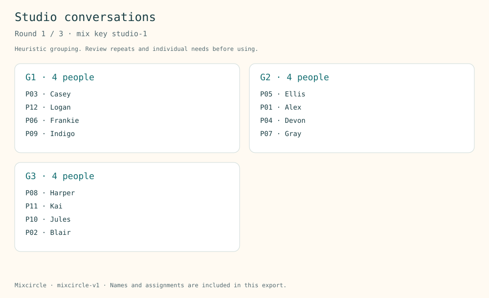

# Mixcircle

**Mix the room. See the repeats.** Plan balanced breakout groups across several rounds, then inspect who meets whom and where pairings repeat.

## Features

- **2–48 people**, **1–12 groups** and **1–8 rounds**.
- Everyone appears exactly once in every round; no empty groups, and sizes differ by at most one.
- A reproducible mix key and versioned search algorithm.
- Independent recount of pair meetings, repeated pairs, per-person exposure and solo placements.
- Round-by-round group cards, searchable/paged pair tables and complete local exports.
- Editable project files, JSON reports, Markdown briefs and selected-round SVG cards.

No account, uploads, analytics, paid APIs or runtime dependencies. Nothing is sent to a meeting platform or to participants.

**This is a bounded heuristic, not an optimality or no-repeat guarantee.** Balanced group sizes do not guarantee equal individual exposure, demographic fairness, suitable room capacity or accommodation needs.

## Example

The fictional [editable project](examples/project.json) uses 12 people, 3 groups and 3 rounds with mix key `studio-1`:

| Observation | Result |
| --- | --- |
| Possible distinct pairs | 66 |
| Total shared-group pair meetings | 54 |
| Distinct pairs that meet | 48 |
| Repeat pair meetings | 6 |

Actual generated round-one cards:



This is genuine [SVG output](examples/round-1.svg), **not a screenshot**. The complete [JSON report](examples/report.json) and [Markdown brief](examples/brief.md) include every round, all 66 possible pairs and per-person statistics.

A real editor screenshot and native browser visual/responsive checks remain pending. Responsive CSS, labels and keyboard controls are implemented, but this is not a completed accessibility audit.

## Run locally

Node.js 22 or 24 and npm:

```sh
npm ci --ignore-scripts --no-audit --no-fund
npm test
npm run build
npm run dev
```

Open http://127.0.0.1:4192. The preview binds to loopback and serves only the twelve allowlisted app assets in `dist/`; stop with Ctrl+C.

Build and example generation use Node built-ins. jsdom 26.1.0 is pinned for **tests only** and is not included in the deployed app. `npm run example` regenerates the checked-in outputs.

## Use

1. Enter a session title and participant labels, one per line. Initials or aliases are fine.
2. Choose the number of groups and rounds. Groups cannot exceed the participant count.
3. Enter a **mix key**, then select **Make the rounds**.
4. Review each round, solo-placement warnings, per-person exposure and the pair audit.
5. Download a full report or the selected round's SVG. Save an editable project before closing.

Change the mix key to try a different mix. The same algorithm version, ordered roster, options and key reproduce the same assignments. Different keys can collide or produce identical results; there is no unique-output promise.

Changing inputs clears assignments and old download URLs until you generate again. Round selection and pair filters change only the view or the selected-round SVG; complete reports retain all accepted data. Invalid imports preserve current work, and a delayed import cannot overwrite newer input edits.

## Reading the audit

If Alex and Blair share a group in three rounds:

- They form **one distinct pair that met**.
- They form **one repeated pair**.
- Their first meeting is new, followed by **two repeat pair meetings**.
- Each person has one distinct partner, three meeting slots and two repeat slots from this pairing.

The full pair audit contains **every unordered participant pair**, including pairs with zero meetings, along with the exact round numbers. IDs `P01`, `P02`, and so on follow the nonblank ordered roster. Reordering the roster changes which person receives which ID.

A group's label, such as `G1`, is not a room-capacity assignment or a role. Larger balanced groups use earlier labels. The tool does not rotate people through named physical stations.

The simple pair-count lower bound is max(0, total pair meetings minus possible distinct pairs). It can be zero even when a repeat-free design is impossible for other reasons. It is **not** a proof that this result is optimal or that a repeat-free plan exists.

Solo groups can occur when group count is high. They are counted explicitly across rounds and contribute no pair meetings.

## Search method and limits

Algorithm version: **mixcircle-v1**.

For each round, the mixer tries at most **24 seeded shuffled candidates**, with up to **80 cross-group swap attempts per candidate**. Only improving swaps are retained. It stops early on a round with no repeats.

The objective is lexicographic:

1. Minimize meetings between pairs that have already met in earlier rounds.
2. For ties, reduce the sum of those pairs' prior meeting counts, discouraging concentrated repetition.

Earlier rounds are not reconsidered. There is no global search proof, exhaustive constraint solver or optimality certificate. The independent audit recounts the finished assignments rather than trusting the search's history matrix.

The pseudo-random mix key is intended for reproducibility, **not secure draws**. This is not a statistical fairness guarantee. No demographic, role, keep-together, keep-apart, facilitator, accessibility, capacity or platform constraints are supported. Review the group plan against individual needs before using it.

### Input contract

| Input | Limit |
| --- | --- |
| Roster | 2–48 nonblank participant labels; source up to 5,000 UTF-16 units |
| Each label | 1–60 printable UTF-16 units after trimming |
| Title | 1–80 printable units, no edge whitespace |
| Mix key | 1–40 printable units, no edge whitespace |
| Groups | Integer 1–12, no more than the participant count |
| Rounds | Integer 1–8 |
| Editable project | 12,000 text units; file import up to 40,000 bytes, fatal UTF-8 decoding |

Roster blank lines are ignored and JavaScript `trim()` removes surrounding whitespace. Exact duplicate trimmed labels are rejected; add an initial or suffix for people with the same label. Case-sensitive labels are not Unicode-normalized, and two distinct labels are not proof they identify distinct people.

Control/format characters, Unicode line separators and unpaired surrogates are unsupported. This restricted display-label format does not represent every personal name; use a suitable display alias if necessary.

Projects preserve canonical participant labels/order and settings, not original blank lines or whitespace. A project specifies the algorithm version; unsupported versions are rejected. Keep a complete JSON report if you need an authoritative snapshot of the actual assignments across future software changes.

## Exports and privacy

| Output | Contains |
| --- | --- |
| JSON report | Configuration, algorithm, all assignments, all possible pair observations, per-person and per-round audits |
| Markdown brief | All groups/labels, per-person exposure and every possible pair with meeting rounds |
| Selected-round SVG | Every member in that round, with abbreviated visual labels and full label tooltips |
| Editable project | Canonical roster, title, group/round counts, mix key and algorithm version |

Pair tables page at 30 records and can be filtered. No pair rows are omitted from complete reports. All participant labels appear in the on-page group cards; SVG labels may be shortened for layout. Check font rendering, fit and print scaling before sharing or printing. Physical print output is unverified.

Exports include participant labels and relationship structure. Review before sharing. No application storage, uploads or analytics are used; the browser may restore a tab, and the host may retain ordinary infrastructure logs. No messages, calendar invitations or breakout-room changes are sent.

## Verification

`npm test` passes **25 checks**, including a parent test and ten real application-handler subtests in **jsdom**:

- Roster bounds, source-line diagnostics, duplicate labels, settings and seeded determinism.
- Varied sizes up to 48 participants: each participant appears once, no groups are empty, and sizes remain balanced.
- Independent literal pair recount and accounting identities across **36 configurations**.
- Rejection of tampered/imbalanced assignments and explicit handling of unavoidable repeats and solo placements.
- Complete reports despite 276-pair paged/search views, selected-round SVG refresh, stale URL cleanup and project saves.
- Malformed UTF-8/JSON/oversized imports preserving inputs and delayed-import edit protection.
- Maximal project bounds, inert markup, escaped well-formed SVG and safe Markdown fences.

CI runs tests/builds on Node 22 and 24, Windows and Linux, with pinned official GitHub Actions. Simulated DOM/XML tests do **not** verify native browser rendering, responsive appearance, assistive-technology behavior, downloaded file destinations or physical printing. Native visual checks and a real editor screenshot remain incomplete.

## Deploy on Vercel

Import the repository into your existing account. Select **Other**, repository root, build `npm run build`, output `dist`, and Node 22 or 24. `vercel.json` supplies build/output settings, an empty install command (build needs no dependencies), and static response headers.

No environment variables, database, paid integrations or external API are required. GitHub main pushes can be configured to deploy; verify the exact commit and production URL when publishing changes.

## Reference

[CSPLib Social Golfers Problem](https://www.csplib.org/Problems/prob010/) describes the established pair-rotation problem and variants. Mixcircle implements its own bounded heuristic; it is not an exact solver and makes no novelty, independently verified demand or optimality claim.

MIT licensed.
